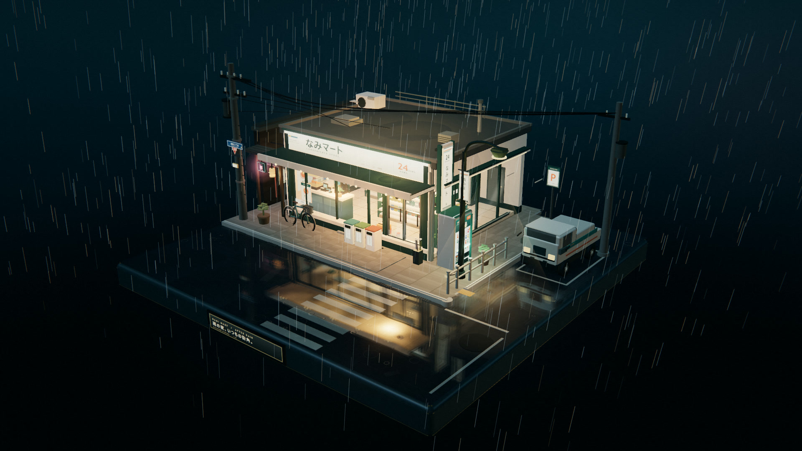
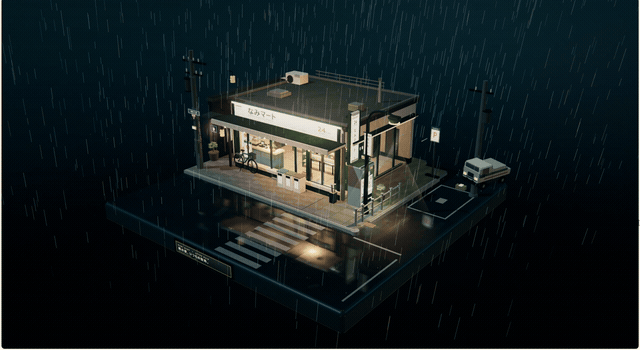
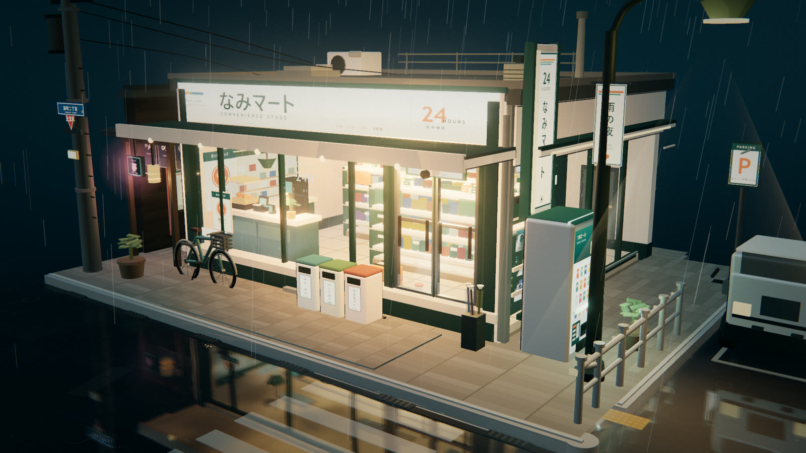
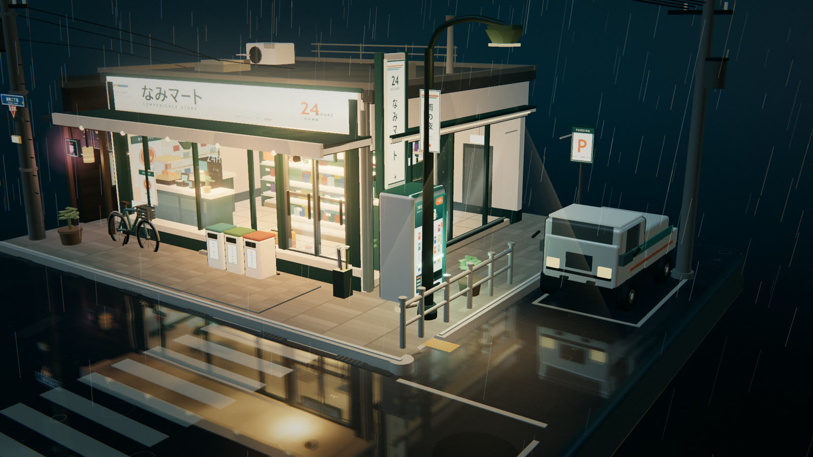
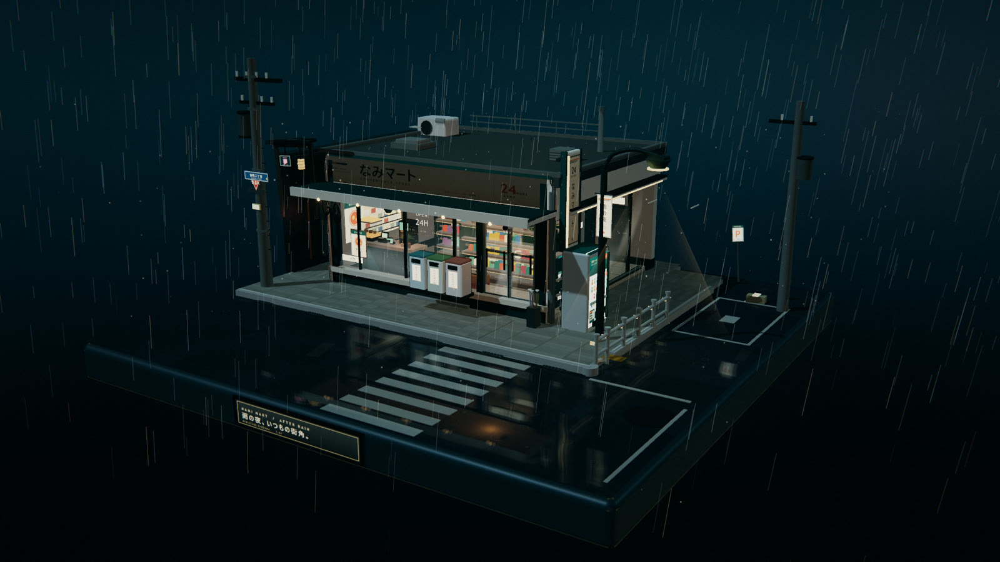

# 雨夜便利店 · NAMI MART

  <strong>三渲二 · 日式雨夜 · 便利店街角 · 可自由拖拽 / 旋转 / 缩放的微缩三维模型</strong>

  <a href="assets/demo.mp4">▶ 观看 12 秒演示视频</a>
  &nbsp;·&nbsp;
  <a href="index.html">打开单文件场景</a>
  &nbsp;·&nbsp;
  <a href="src/">源码</a>

  

> 像一帧被定格下来的日本动画街角：雨一直下，店里一直亮着。
> 所有场景元素都搭在一个完整的正方形底座上，没有任何 UI 覆盖层。

---

## 演示

*点击动图播放完整 MP4（12 秒，已裁掉浏览器工具栏并去音轨）*

  <a href="assets/demo.mp4"><strong>▶ 直接打开 assets/demo.mp4</strong></a>

> 演示录屏由作者提供；仓库中的 MP4 / GIF 是裁剪、压缩后的 README 版本。

## 画面

| 店面近景 | 街角与小货车 |
|:---:|:---:|
|  |  |

展开：入场组装过程截图

 

  

## 交互

| 操作 | 效果 |
| --- | --- |
| 鼠标拖拽 / 单指拖动 | 环绕观察整个模型 |
| 滚轮 / 双指捏合 | 拉近与拉远 |
| 松手 | 带阻尼的平滑惯性 |
| 首次打开页面 | 自动播放建筑与街道的逐件组装入场动画 |

场景没有标题栏、按钮、提示文字或任何 HUD；整个画面只有模型与雨夜。

## 场景与动效

- **底座**：完整正方形收藏底座、黄铜包边、铭牌、湿润反光路面。
- **外部**：主灯箱招牌、竖招牌、玻璃橱窗、滑动玻璃门、雨棚、地垫、自行车、雨伞架、分类垃圾桶、自动贩卖机、护栏、停车位、斑马线、路灯、电线杆与电线、路牌、小巷、霓虹灯、公告栏、小型货车。
- **店内**：明亮的暖色灯光、整齐货架、饮料冷柜、便当与零食、收银台、热食柜、咖啡机、杂志架、海报、灯箱、后场门。
- **动效**：持续降雨、雨雾、湿地面实时反射与涟漪、玻璃雨水流动、招牌/店内灯光点亮与轻微闪烁、模型逐件飞入的入场组装动画、尘埃、Bloom 与暗角调色。
- **人物**：无。

## 技术栈

- **Three.js r180 / WebGL2 / vanilla ES modules**
- **esbuild** 打包为单文件 IIFE；最终 HTML 不依赖外部资源、无需联网
- 所有招牌、海报、路面、沥青、斑马线纹理均由 **Canvas 2D** 程序化生成
- 自定义 MeshToonMaterial 渐变、BackSide 描边与玻璃反射层
- Reflector + 自定义 shader 湿地面；EffectComposer + UnrealBloomPass + finishing shader

## 运行

仓库里的 <code>index.html</code> 是**单文件构建产物**，下载后双击即可打开，无需服务器、无需安装。

<pre><code>git clone https://github.com/zhihan0704/Rainy-Night-Convenience-Store.git</code></pre>

从源码构建：

<pre><code>npm install
npm run build
# 输出根目录 index.html</code></pre>

启动本地静态服务器：<code>npx serve .</code>

GitHub Pages：在仓库 Settings → Pages 中选择 Deploy from a branch → main → /(root)。

## 项目结构

<pre><code>.
├─ index.html                 # 单文件场景
├─ src/
│  ├─ main.js                 # 渲染器、相机、灯光、装配编排、循环
│  ├─ world.js                # 底座、街道、人行道、斑马线、积水
│  ├─ store.js                # 便利店建筑与店内陈设
│  ├─ props.js                # 街角道具（车、贩卖机、自行车、灯、电线等）
│  ├─ fx.js                   # 天空、湿地面、雨、尘埃、后期
│  ├─ lib.js                  # Toon 材质、描边、几何辅助
│  ├─ textures.js             # Canvas 程序化招牌/海报/路面纹理
│  └─ index.template.html     # 构建 HTML 模板
├─ scripts/build.mjs          # esbuild 打包 + 内联
├─ assets/                    # 演示视频、GIF、预览截图
├─ package.json
└─ README.md</code></pre>

## 原始提示词

> 请制作一个雨夜便利店街角小场景，以第三视角观察整个场景，整体像一个可以自由拖拽、旋转、缩放观看的微缩三维模型 / 小型景观，没有任何UI界面元素。地面为一个完整的正方形底座，所有元素都搭建在这个底座上，构图紧凑、层次清晰，整体呈现出小巧、精致、可收藏的模型感。画面风格为三渲二，强调浓厚的日式二次元动画氛围，材质表现干净，轮廓明确，色彩柔和但富有夜景霓虹的层次感。
>
> 场景主体是一处日式便利店街角，便利店位于底座的视觉中心，外部有典型的日式街角元素：便利店招牌、玻璃橱窗、自动门、屋檐雨棚、门口地垫、自动贩卖机、自行车、雨伞架、垃圾桶、路灯、电线杆、电线、路牌、街角护栏、停车位、排水沟、积水路面、反光斑马线、小巷入口、空调外机、小型公告栏或海报栏等。街道不需要太大，但要有明确的街角转折感，像日本动画里常见的夜晚社区一角。不要人物，但便利店内部一定要有足够内容，并且可以透过大面积玻璃窗清楚看到店内。店内可见典型便利店陈设，例如：整齐排列的货架、饮料柜、便当区、饭团和零食陈列、收银台、咖啡机、杂志架、宣传海报、店内灯箱、冰柜、关东煮柜台、地面导视、储物柜或后场门等。要让便利店内部显得明亮、温暖、真实、充实，与室外潮湿昏暗的雨夜形成鲜明对比，营造出非常典型的日式动画雨夜氛围。
>
> 美术风格重点强调：高精细建模、三渲二卡通渲染、清晰的轮廓线、细腻但简洁的材质层次、湿润的夜景反光、暖色室内灯光与冷色雨夜街景对比、浓厚的二次元日常场景感。整体气质应偏向安静、治愈、带一点都市夜晚孤独感但依然温暖，像一幕被定格下来的日本动画街角场景模型。
>
> 加入一些基础动效来增强生命力：持续降雨、屋檐滴水、地面积水波纹、便利店招牌或灯箱轻微闪烁、自动门偶尔开合、雨水沿玻璃滑落、街道路面积水反射灯光、远处交通信号灯微弱变化等。整体效果应像一个静止而精致的三维微缩世界，但带有恰到好处的细微动态，突出其三渲二、二次元、雨夜、便利店、街角、小巧精致的核心特征。整体模型制作完毕后，增加建筑入场动画，从地面开始慢慢组装模型元素等往上叠加，由散件组成完整场景的效果。

## 说明

- 这是视觉展示向的单页 3D 场景，没有人物、没有外部素材库、没有运行时网络请求。
- Three.js 按 MIT License 使用；场景代码与 Canvas 程序化美术均为本项目内容。
- 演示录屏中的浏览器工具栏已裁切，视频无音轨。

---

  Rainy Night Convenience Store · NAMI MART · 2026

